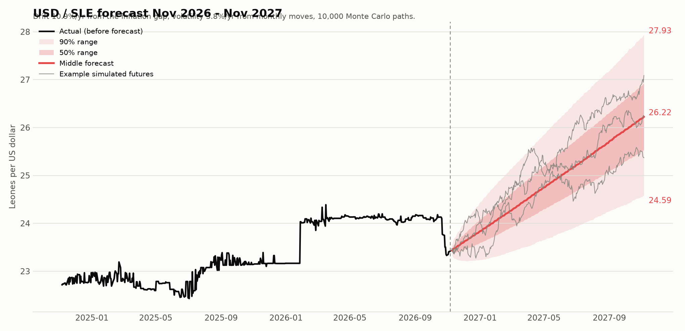

# Currency prediction: USD/SLE stochastic forecast

How many Sierra Leonean leones (SLE) will one US dollar cost over the next 12 months, how uncertain is that, and what does that uncertainty mean for matching remittance flows with investors who need dollars?

The model is a geometric Brownian motion (GBM). Its drift comes from the **inflation gap** (relative purchasing power parity) and its volatility from **monthly** moves over the last 3 years:

```
ln S(t+dt) = ln S(t) + mu*dt + sigma*sqrt(dt)*eps,   dt = 1/252

mu    = ln(1 + inflation_SL) - ln(1 + inflation_US)
sigma = std(21-day log changes, last 3 years) * sqrt(252/21)
```

From this model, the code:

* runs 10,000 Monte Carlo paths and checks them against the closed-form solution
* runs an out-of-sample test (forecast made on 31 Oct 2025, scored against what happened Nov 2025 – Oct 2026), plus a backtest over 28 quarterly dates (2017–2024) against *no drift* and *no change* benchmarks
* compares three kinds of random shocks: normal, Student t (fat tails) and 21-day block bootstrap
* covers risk and liquidity: a stress scenario with sudden devaluations, the probability the rate touches a trigger level, how well remittances can be matched with investors' dollar needs, and expected losses on a guarantee
* produces 12-month and 5-year forecasts made on 6 Nov 2026
* runs the same code, unchanged, on GHS, NGN and KES



## Repository layout

```
.
├── usd_sle_daily.ipynb      # full write-up: derivations, explanations, all results
├── usd_sle_daily.pdf        # PDF export of the notebook
├── src/fxforecast/
│   ├── config.py            # settings, inflation inputs, test/backtest dates
│   ├── data.py              # download (Yahoo, Wise), despike, splice, snapshot hashing
│   ├── model.py             # calibrate, simulate (normal / t / bootstrap, jumps), closed-form bands
│   ├── evaluation.py        # CRPS, coverage, out-of-sample test, backtest, shock comparison
│   ├── risk.py              # trigger probabilities, hedge matching, guarantee loss
│   └── plotting.py          # history and fan charts
├── scripts/run_forecast.py  # end-to-end pipeline (command line)
├── tests/test_model.py      # unit tests (Monte Carlo vs formula, CRPS, risk functions)
└── data/                    # frozen raw data snapshot + manifest + exported figures/CSVs
```

## Quick start

```bash
python -m venv .venv
source .venv/bin/activate        # Windows: .venv\Scripts\activate
pip install -r requirements.txt

python scripts/run_forecast.py                   # full run on the frozen snapshot -> outputs/
python scripts/run_forecast.py --skip-backtest   # faster
pytest                                           # unit tests
jupyter notebook usd_sle_daily.ipynb             # the full write-up
```

Use as a library:

```python
import sys; sys.path.insert(0, "src")   # or: pip install -e .
from fxforecast.data import build_usd_sle
from fxforecast.model import calibrate, simulate, horizon_until

s = build_usd_sle()
p = calibrate(s, s.index[-1], infl_local=15.66, infl_us=3.7)
paths = simulate(p, horizon_until(s.index[-1], 1))   # (10000, ~260) array of rates
```

## Reproducibility

The analysis runs on a frozen snapshot of the raw CSVs in `data/`, ending on **6 Nov 2026**. `data/snapshot_manifest.json` stores a SHA-256 hash of every file, and every run checks the files against it and stops if any of them has changed. Pass `--refresh` (or set `REFRESH = True` in the notebook) only when you deliberately want to download new data. Doing so rewrites the manifest.

**Data sources:** Yahoo Finance `SLL=X` (2015 until Wise coverage begins) and Wise mid-market history (the last 5 years). Pre-redenomination SLL quotes are divided by 1000 (1 SLE = 1000 SLL, 1 Jul 2022).

## Recalibrating

1. Update `INFLATION_LIVE` in [`src/fxforecast/config.py`](src/fxforecast/config.py) (and in the notebook) with the latest published consumer price inflation (CPI) figures and their sources.
2. Run with `--refresh` to pull new prices, then run normally.
3. Check that the Monte Carlo results and the closed-form results agree.

## Known limitations

* Inflation is only a long-run anchor. Over a single year, currencies often move against the inflation gap (central bank intervention, aid inflows, pegs).
* `mu` and `sigma` stay constant over the whole horizon, so the 5-year range is a scenario, not a forecast.
* Jumps appear only in the stress scenario, and their size and frequency are chosen by hand, not estimated from data.
* The rates are mid-market and ignore spreads. The liquidity inputs (`NOTIONAL_USD`, `DAILY_REMIT_USD`) are placeholders.
